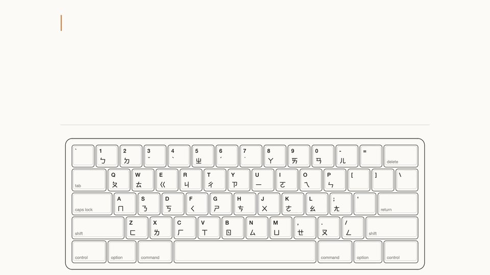

# keyflip

A Zhuyin (Bopomofo) input method that decides by itself whether you are typing
Chinese or English. No Shift or CapsLock toggling.



Every frame is drawn from the engine's own keystroke trace (`keyflip-cli trace`), not
mocked. The [full 34 s film with sound](https://github.com/Hsiang-Tang/keyflip/releases/download/v0.1.1/keyflip-demo.mp4),
with path handling, Tab completion, a corrected guess and a remembered word, is rebuilt
with `node demo/render.mjs all` (`demo/`).

If a judgment is wrong, press Tab to flip between Chinese and English. Enter commits
exactly what the composition shows. Everything else behaves like Microsoft
New Zhuyin.

## Demo

Real output of the core simulator, `keyflip-cli play '<keys>'` (`<E>` is Enter,
`<T>` is Tab):

```
keys                   committed
su3cl3Hsiang<E>        你好Hsiang      Zhuyin, then an English name
githubji3<E>           github我        English, then Chinese with no space
Hsiang_su3cl3<E>       Hsiang 你好     Space ends the English word
ai<E>                  ㄇㄛ            "ai" is also valid Zhuyin, so Chinese wins
ai<T><E>               ai              one Tab flips it to English
su3cl3_./ai<E>         你好./ai        paths keep half-width punctuation
```

## Accuracy

Measured on 2026-10-24 with `cargo run --release -p keyflip-cli -- eval` (local
run, no user model):

| Set | Size | Result |
| --- | --- | --- |
| Chinese phrases | 4,940 | 0 leaked into English; 89.2% exact characters |
| Chinese + English + Chinese, spaced | 2,858 sentences | 0 wrong |
| Chinese + English + Chinese, glued | 1,682 sentences | 17 wrong (1.0%) |
| English words, ranks 0 to 10,000 | 10,000 | 21 misjudged (0.2%) |
| English + digit tokens | 2,925 | 8 changed (0.3%) |

On 2026-10-25 `cargo test --workspace` passes 86 tests, one of which runs all 54
acceptance cases.

## Status

- Core engine: complete, tests pass (`crates/keyflip-core`).
- macOS shell: universal (Apple Silicon and Intel, macOS 12 or later) and in daily use
  by the maintainer on Apple Silicon; the full hand-test checklist is not yet complete (`macos/`,
  `crates/keyflip-ffi`).
- Learning: picks from the candidate window, your own phrases, and English words you
  type are remembered on this Mac (`specs/004-user-lexicon/`).
- macOS only. The Windows shell is frozen and unmaintained (ADR-0008).

Details: `docs/STATUS.md`.

## Try the core (no installation)

```
cargo run -p keyflip-cli -- play 'su3cl3Hsiang<E>'
cargo run --release -p keyflip-cli -- eval
```

Key notation: `specs/001-mixed-input/acceptance.md`.

## Build and install

```
cargo test --workspace
bash macos/build.sh --no-install   # build only
bash macos/build.sh                # build and install into ~/Library/Input Methods
```

Needs Rust and the Xcode command line tools. macOS needs no administrator rights.
Full guide: `specs/002-platform-shells/macos.md`. A signed, notarized release is built
with `macos/release.sh` (setup steps in its header).

## Install a release

1. Download `keyflip-<version>-macos.zip` from the GitHub releases page and double-click
   it in Finder to unzip.
2. Double-click `Keyflip.app`. It installs itself and a dialog tells you the one step left
   (adding it in Keyboard settings, or logging out and back in if macOS needs that).
   No folders to find, no Terminal.
3. In Keyboard settings > Input Sources, turn off "Use the Caps Lock key to switch to and from ABC", so
   CapsLock types capitals.

## Your dictionary

The input menu has "Open User Dictionary Folder"
(`~/Library/Application Support/keyflip/`):

- `phrases.txt`: your own words, one per line as `text<Tab>readings`, for example
  `鍵翻<Tab>ㄐㄧㄢˋ ㄈㄢ`. Picked up when you switch back to keyflip.
- `learned.tsv`, `english.tsv`, and `short-english.tsv`: what keyflip learned. A short
  word such as `ai` that you turn into English with Tab once stays English the next
  time (`ai3` still gives 抹). Delete a line to forget it,
  or use "Clear Learned Choices" (the old files are kept as `.bak`).

## Documentation map

- `.specify/memory/constitution.md`: project principles.
- `specs/`: specifications, plans, tasks, acceptance cases, research.
- `docs/`: product, architecture, roadmap, status, verification log, ADRs.

## How this was built

The maintainer defined the problem, the judgment rules, and every acceptance case
(`specs/001-mixed-input/acceptance.md`), and tests each build by typing on it daily.
AI coding agents wrote the implementation under spec-driven development: a behavior
change starts as a requirement and an acceptance case, then code; decisions are
recorded in `docs/adr/`. Correctness is checked by the acceptance cases, the test
suite, and the evaluation set above, all run locally.

The hard part is that Zhuyin keys are Latin letters: `ai` is both an English word
and the syllable ㄇㄛ. Chinese typed right after an English word with no space
(MI-23) was wrong in every case at first; it is now 1.0% wrong. Fixed product
rules keep the scope honest: no modifier-tap gestures (ADR-0002), judgment only in
the engine (ADR-0001), macOS only (ADR-0008).

## License and data sources

The source code is MIT licensed (`LICENSE`). The data files derive from McBopomofo
(MIT), libtabe (BSD-style), and wordfreq (CC BY-SA 4.0). See `NOTICE` and
`THIRD_PARTY_LICENSES.md`.
